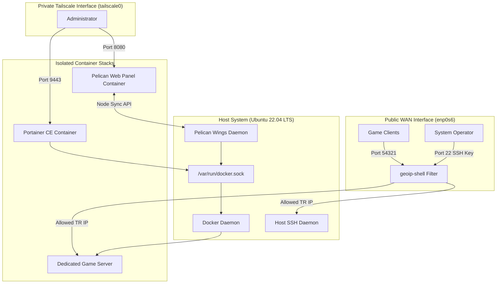
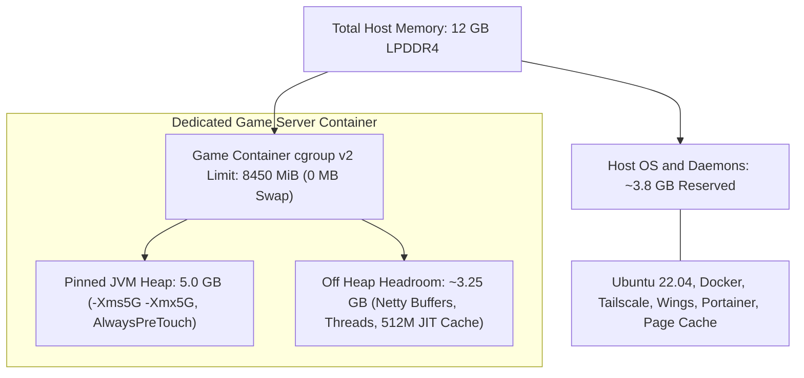

# OCI ARM64 Infrastructure and Game Server Platform

[](https://cloud.oracle.com/)
[](https://amperecomputing.com/)
[](https://tailscale.com/)
[](https://pelican.dev/)
[](LICENSE)

**Languages:** [English](README.md) | [Türkçe](README.tr.md)

This repository contains the system configurations, setup scripts, and operational runbooks from my personal Oracle Cloud (OCI) Ampere A1 ARM64 server.

I set up this host on an Always Free `VM.Standard.A1.Flex` instance (2 OCPUs and 12 GB RAM in Frankfurt) to run isolated game server containers through Pelican alongside standalone Docker compose stacks managed in Portainer CE. Hosting a dedicated Minecraft server for players connecting from Turkey within fixed 12 GB RAM and 3.0 GHz ARM64 cores meant tuning the Linux kernel, partitioning container memory under cgroups v2, building a custom GraalVM 25 runtime image, and locking all admin dashboards behind Tailscale.

## 1. Architecture Overview

The system separates public game ingress, private encrypted administration, and container orchestration into three distinct boundaries:
- **Public Ingress (WAN):** Port 22 (SSH with key authentication only) and Port 54321 (game traffic) on physical interface `enp0s6`, filtered by `geoip-shell` to block traffic from outside Turkey at the firewall level.
- **Private Management (VPN):** Portainer (9443) and Pelican Panel (8080) bind strictly to the Tailscale interface (`tailscale0`), keeping administrative web interfaces invisible to the public internet.
- **Container Control Plane:** The Pelican Wings daemon on the host communicates with Docker over `/var/run/docker.sock` to orchestrate isolated container workloads under cgroups v2 limits.



### Production Telemetry and Dashboards

| OCI Host Details | Pelican Multi Tenant Dashboard |
| :---: | :---: |
|  |  |
| *Ampere A1 instance with 2 OCPUs and 12 GB RAM in Frankfurt* | *Pelican panel managing active and standby container runtimes* |

| Host Process Telemetry and 48 Day Uptime | Portainer Dashboard |
| :---: | :---: |
|  |  |
| *htop showing 48 days uptime, 6.55G memory load, and low CPU jitter* | *Portainer instance showing container details* |

| Container Resource and Memory Limits |
| :---: |
|  |
| *Container environment settings with 8450 MiB limit, swap disabled, and custom GraalVM image* |

## 2. Technical Architecture and Decisions

### Service Layout and Docker Socket Sharing
- Pelican Panel runs inside Docker, serving the web UI for managing games and server allocations.
- Pelican Wings runs on the host as a systemd service (`wings.service`). It listens for instructions from the panel and manages game containers via `/var/run/docker.sock`.
- Portainer runs alongside them in Docker to manage standalone containers, compose stacks, and general Docker workloads outside of Pelican.
- Both Portainer and Pelican Wings require access to `/var/run/docker.sock` to manage containers. Because socket access is root equivalent, game workloads never touch the Docker socket and run as unprivileged child containers.

### Container Memory Sizing Budget
To ensure the game server container never starves the host operating system or triggers disk swapping, I partitioned the 12 GB physical memory into strict boundaries:



- **Host Overhead (~3.8 GB):** Reserved for Ubuntu 22.04 LTS, the Docker daemon, Tailscale, Pelican Wings, Portainer CE, and kernel page cache.
- **cgroup v2 Ceiling (8450 MiB, Swap Disabled):** Pelican caps the game container at 8450 MiB with swap set to 0 MiB, enforced by Docker through Linux cgroups v2. Disabling swap prevents disk thrashing that would stall game tick rates, and if memory usage ever exceeds 8450 MiB, the kernel cgroup OOM killer terminates only the game container while keeping the host alive.
- **Pinned JVM Heap (5 GB):** Pinned using `-Xms5G -Xmx5G` combined with `-XX:+AlwaysPreTouch` so Linux maps and zeroes all physical heap pages at container boot, avoiding page fault stutters during world chunk loading.
- **Off Heap Headroom (~3.25 GB):** Leaves dedicated headroom inside the container for Netty direct network buffers, thread stacks, JIT code cache (`ReservedCodeCacheSize=512M`), and native libraries.

### Network Model and GeoIP Firewall
Only two ports accept connections from the public WAN interface (`enp0s6`):
- Port 22 (SSH): Publicly accessible, but passwords are completely disabled (`PasswordAuthentication no` in `sshd_config.d/60-cloudimg-settings.conf`). You must have the authorized SSH private key to log in.
- Port 54321: Dedicated port for game client traffic.

All management dashboards (Portainer on 9443 and Pelican Panel on 8080) are strictly private. They bind only to the Tailscale interface (`tailscale0`), keeping administration completely off the public internet.

On the WAN interface, `geoip-shell` drops inbound packets from outside Turkey (`TR`) using daily RIPE registry IP sets. Internal ranges (`100.64.0.0/10` for Tailscale and `169.254.0.0/16` for OCI metadata) are whitelisted so cloud monitoring and VPN traffic never drop.

### Kernel Network and Storage Tuning
- TCP BBR and FQ Pacing: Enabled `tcp_congestion_control = bbr` and `default_qdisc = fq` in `/etc/sysctl.d/99-game-server.conf`. Pacing packets based on estimated bandwidth and RTT reduces jitter and packet loss penalties over international WAN routes between Frankfurt and players in Turkey.
- Dirty Page Writeback: Lowered `vm.dirty_background_ratio` to 5 and `vm.dirty_ratio` to 10. This forces the kernel to flush modified memory pages to disk in small, continuous streams instead of holding large batches that cause I/O stalls during game world autosaves.

### Workload Runtimes and ARM64 GraalVM Optimization
Pelican isolates each game server in a separate container using runtime templates called Eggs:
- Native Binaries (C/C++, Go, Rust): Games built on native engines execute directly in lightweight Linux containers with zero runtime translation overhead.
- Minecraft Server Workload: The primary workload on this host is a Minecraft server. Unlike multithreaded web services, Minecraft runs its core game loop on a single thread at a fixed rate of 20 ticks per second (50 ms per tick). On Ampere Altra ARM64 cores, lower single core clock speeds (3.0 GHz) make JIT warmup delays and garbage collection pauses directly noticeable as tick drops.

To get higher single thread throughput on ARM64 without changing host packages, I built a custom runtime image (`docker/graalvm-arm64/Dockerfile`) on Debian ARM64 (`ghcr.io/pelican-eggs/yolks:debian`) with GraalVM Community Edition JDK 25. GraalVM's modern escape analysis, loop unrolling, and method inlining passes generate tighter ARMv8 machine code for hot tick loops than the default OpenJDK HotSpot C2 compiler.

### Live Storage Expansion
When my 50 GB boot volume ran low on space, I expanded it to 100 GB (and tuned it to 30 VPUs) in the OCI console without rebooting the VM. The Linux kernel detected the new SCSI drive capacity immediately, `growpart /dev/sda 1` updated the GPT partition table, and `resize2fs /dev/sda1` expanded the ext4 filesystem online while containers stayed running. See [`scripts/setup-storage.sh`](scripts/setup-storage.sh) and the [storage expansion runbook](docs/runbooks/storage-expansion-vpu-tuning.md) for details.

### Serial Console Recovery
While testing local iptables rules, I once locked myself out of port 22 and accidentally blocked the link local metadata address `169.254.169.254`, cutting off both SSH and the OCI guest agent.

I recovered the instance without rebuilding it by opening the OCI Cloud Shell serial console, interrupting the GRUB bootloader, booting into a root shell with `rw init=/bin/bash`, setting a local rescue password for `ubuntu`, and flushing the broken iptables rules. See the [disaster recovery runbook](docs/runbooks/disaster-recovery-serial-console.md) for the full procedure.

## 3. Repository Structure

```text
├── docs/
│   ├── architecture.md                        # Network topology and system details
│   ├── architecture.tr.md                     # Turkish architecture documentation
│   └── runbooks/
│       ├── disaster-recovery-serial-console.md    # Serial console recovery guide
│       ├── disaster-recovery-serial-console.tr.md # Turkish serial console recovery guide
│       ├── storage-expansion-vpu-tuning.md        # Online disk expansion guide
│       └── storage-expansion-vpu-tuning.tr.md     # Turkish disk expansion guide
├── scripts/
│   ├── geoip-shell.conf                       # Active geoip-shell configuration
│   ├── setup-firewall.sh                      # Firewall and geoip-shell installer
│   ├── setup-storage.sh                       # Live partition and filesystem expansion script
│   └── setup-system.sh                        # Network forwarding and kernel sysctl tuning
├── systemd/
│   ├── wings.service                          # Pelican Wings systemd unit
│   └── iscsid.service.d/
│       └── restart-policy.conf                # OCI platform default storage daemon restart policy
├── docker/
│   ├── graalvm-arm64/
│   │   └── Dockerfile                         # GraalVM 25 ARM64 container build
│   ├── pelican-panel/
│   │   └── docker-compose.yml                 # Pelican Web Panel compose file
│   ├── portainer/
│   │   └── docker-compose.yml                 # Portainer CE compose file
│   └── wings/
│       └── config.example.yml                 # Sanitized Wings daemon configuration
├── .env.example                               # Sample environment variables
├── LICENSE                                    # MIT License
├── README.md                                  # English documentation
└── README.tr.md                               # Turkish documentation
```

## 4. Setup Instructions

1. Configure environment variables:
   ```bash
   cp .env.example .env
   ```

2. Apply kernel and sysctl tuning:
   ```bash
   sudo ./scripts/setup-system.sh
   ```

3. Install and configure geoip-shell and firewall rules:
   ```bash
   sudo ./scripts/setup-firewall.sh
   ```

4. (Optional) Build the custom GraalVM ARM64 container for Java workloads:
   ```bash
   docker build -t local/pelican-graalvm:25 docker/graalvm-arm64/
   ```

5. Deploy management services:
   ```bash
   docker compose -f docker/pelican-panel/docker-compose.yml up -d
   docker compose -f docker/portainer/docker-compose.yml up -d
   ```

## 5. License

This project is licensed under the MIT License. See the LICENSE file for details.
