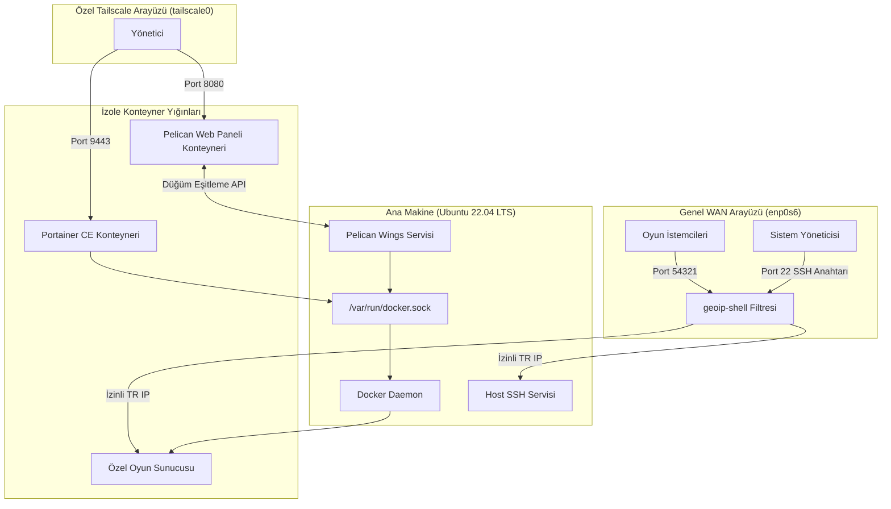
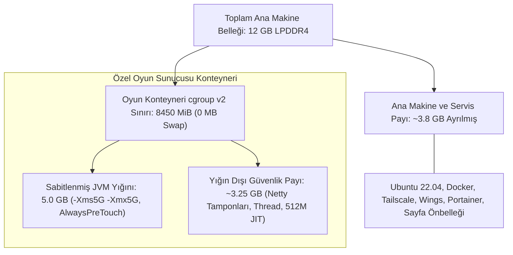

# OCI ARM64 Altyapısı ve Oyun Sunucusu Platformu

[](https://cloud.oracle.com/)
[](https://amperecomputing.com/)
[](https://tailscale.com/)
[](https://pelican.dev/)
[](LICENSE)

**Diller:** [English](README.md) | [Türkçe](README.tr.md)

Bu depo, Oracle Cloud (OCI) üzerindeki kişisel Ampere A1 ARM64 sunucum için hazırladığım sistem yapılandırmalarını, kurulum betiklerini ve işletim rehberlerini içerir.

Bu sunucuyu Always Free katmanındaki bir `VM.Standard.A1.Flex` makinesi (Frankfurt bölgesinde 2 OCPU ve 12 GB RAM) üzerinde, Pelican aracılığıyla izole oyun sunucusu konteynerleri ve Portainer CE aracılığıyla bağımsız Docker compose yığınları çalıştırmak için kurdum. Sabit 12 GB RAM ve 3.0 GHz ARM64 çekirdekleri altında Türkiye'den bağlanan oyunculara özel bir Minecraft sunucusu barındırmak için Linux çekirdeğini ayarladım, konteyner belleğini cgroups v2 altında böldüm, özel bir GraalVM 25 çalışma zamanı imajı derledim ve tüm yönetim panellerini Tailscale arkasına aldım.

## 1. Mimari Genel Bakış

Sistem mimarisi genel kullanıcı erişimini, şifreli özel yönetim düzlemini ve konteyner yönetimini üç net sınıra ayırır:
- **Genel Giriş (WAN):** Fiziksel `enp0s6` arayüzünde yalnızca Port 22 (parolasız, anahtar korumalı SSH) ve Port 54321 (oyun trafiği) açıktır. `geoip-shell` Türkiye dışından gelen trafiği doğrudan güvenlik duvarında düşürür.
- **Özel Yönetim (VPN):** Portainer (9443) ve Pelican Paneli (8080) yalnızca özel Tailscale arayüzünü (`tailscale0`) dinler, böylece web yönetim arayüzleri genel internete tamamen kapalı kalır.
- **Konteyner Kontrol Düzlemi:** Ana makinedeki Pelican Wings servisi `/var/run/docker.sock` üzerinden Docker ile haberleşerek izole konteyner iş yüklerini cgroups v2 sınırları altında yönetir.



### Canlı Panel ve Konsol Görüntüleri

| OCI Sunucu Detayları | Pelican Yönetim Paneli |
| :---: | :---: |
|  |  |
| *Frankfurt bölgesinde 2 OCPU ve 12 GB RAM ile çalışan Ampere A1 makinesi* | *Pelican paneli üzerinde aktif ve hazırda bekleyen konteyner çalışma zamanları* |

| Süreç Telemetrisi ve 48 Günlük Çalışma Süresi | Portainer Konteyner Listesi |
| :---: | :---: |
|  |  |
| *htop ekranında 48 günlük kesintisiz çalışma, 6.55G bellek yükü ve düşük CPU dalgalanması* | *Konteyner detaylarını gösteren Portainer örneği* |

| Konteyner Kaynak ve Bellek Limitleri |
| :---: |
|  |
| *8450 MiB sınır, takas alanı kapalı ve özel GraalVM imajı ile çalışan konteyner ortam ayarları* |

## 2. Teknik Detaylar ve Tasarım Kararları

### Servis Mimarisi ve Docker Soket Paylaşımı
- Pelican Paneli Docker içinde çalışır ve sunucu yönetimi için web arayüzü sunar.
- Pelican Wings ana makinede systemd servisi (`wings.service`) olarak çalışır. Panelden gelen komutları dinler ve `/var/run/docker.sock` üzerinden oyun konteynerlerini yönetir.
- Portainer aynı Docker ortamında çalışarak Pelican dışındaki bağımsız konteynerleri, compose yığınlarını ve genel Docker işlerini yönetir.
- Hem Portainer hem de Wings servisleri `/var/run/docker.sock` soketine ihtiyaç duyar. Soket erişimi ana makinede root yetkisine denk olduğu için oyun sunucusu gibi kullanıcı iş yükleri sokete asla dokunamaz ve izole çocuk konteynerler olarak çalışır.

### Konteyner Bellek Bütçesi ve Boyutlandırma
Oyun sunucusu konteynerinin ana makine belleğini tüketmesini ve disk takasına (swap) girmesini önlemek için 12 GB fiziksel belleği katı sınırlarla böldüm:



- **Ana Makine Payı (~3.8 GB):** Ubuntu 22.04 LTS, Docker daemon, Tailscale, Pelican Wings, Portainer CE ve çekirdek sayfa önbelleği için ayrılmıştır.
- **cgroup v2 Tavanı (8450 MiB, Takas Kapalı):** Pelican üzerinde oyun konteyneri takas alanı kapalı (0 MiB) olacak şekilde 8450 MiB ile sınırlandırılmış ve Docker tarafından Linux cgroups v2 üzerinden uygulanmıştır. Takas alanının kapatılması oyun döngüsünü bozan disk takası takılmalarını engeller. Bellek kullanımı 8450 MiB sınırını aşarsa çekirdek cgroup OOM katili ana makineyi etkilemeden yalnızca oyun konteynerini sonlandırır.
- **Sabitlenmiş JVM Yığını (5 GB):** `-Xms5G -Xmx5G` ve `-XX:+AlwaysPreTouch` parametreleriyle Linux'un konteyner açılışında tüm fiziksel yığın sayfalarını eşleyip sıfırlaması sağlanır, böylece harita yüklemelerinde sayfa hatası takılmaları önlenir.
- **Yığın Dışı Alan (~3.25 GB):** Konteyner içinde Netty doğrudan ağ tamponları, iş parçacığı yığınları, JIT derleme önbelleği (`ReservedCodeCacheSize=512M`) ve yerel kütüphaneler için ayrılmıştır.

### Ağ Modeli ve Güvenlik Duvarı
Fiziksel `enp0s6` arayüzünde genel internete yalnızca iki port açıktır:
- Port 22 (SSH): Genel ağa açıktır, ancak parola ile giriş tamamen kapatılmıştır (`sshd_config.d/60-cloudimg-settings.conf` içinde `PasswordAuthentication no`). Yalnızca SSH anahtarı ile giriş yapılabilir.
- Port 54321: Oyuncuların bağlandığı oyun sunucusu portu.

Diğer tüm yönetim servisleri (9443 portundaki Portainer ve 8080 portundaki Pelican Paneli) tamamen gizlidir. Yalnızca Tailscale VPN arayüzünü (`tailscale0`) dinlerler, bu sayede yönetim arayüzleri genel internete hiç açılmaz.

Genel ağ tarafında `geoip-shell` aracı RIPE IP listelerini günlük güncelleyerek Türkiye (`TR`) dışındaki tüm bağlantıları iptables üzerinde doğrudan düşürür. Dahili ağlar (Tailscale için `100.64.0.0/10` ve OCI meta verisi için `169.254.0.0/16`) beyaz listeye alınmıştır, bu sayede bulut izleme servisleri ve VPN bağlantısı kopmaz.

### Çekirdek Ağ ve Depolama Ayarları
- TCP BBR ve FQ Trafik Düzenleme: `/etc/sysctl.d/99-game-server.conf` içinde `tcp_congestion_control = bbr` ve `default_qdisc = fq` etkinleştirildi. Paketleri anlık bant genişliği ve RTT süresine göre düzenli iletmek, Frankfurt ile Türkiye arasındaki uluslararası hatlarda yaşanan gecikme dalgalanmalarını ve takılmaları azaltır.
- Kirli Sayfa Yazma Oranları: `vm.dirty_background_ratio` değeri 5, `vm.dirty_ratio` değeri 10 olarak ayarlandı. Bu ayar çekirdeğin kirli bellek sayfalarını diske biriktirip tek seferde yazmak yerine sürekli ve küçük akışlar halinde aktarmasını sağlayarak oyun dünyası kayıtları (autosave) sırasındaki I/O tıkanmalarını önler.

### İş Yükü Çalışma Zamanları ve ARM64 Üzerinde GraalVM Optimizasyonu
Pelican her oyun sunucusunu Egg adı verilen çalışma zamanı şablonlarıyla ayrı bir konteyner içinde izole eder:
- Yerel İkilikler (C/C++, Go, Rust): Doğrudan yerel oyun motorlarıyla derlenmiş oyunlar, ek bir çeviri katmanı olmadan hafif Linux konteynerlerinde çalışır.
- Minecraft Sunucu İş Yükü: Sunucudaki ana iş yükü bir Minecraft sunucusudur. Çok iş parçacıklı web servislerinin aksine Minecraft, ana oyun döngüsünü saniyede 20 tick (tick başına 50 ms bütçe) çalışan tek bir iş parçacığında yürütür. Ampere Altra ARM64 çekirdeklerinde tek çekirdek saat hızının 3.0 GHz olması nedeniyle JIT ısınma gecikmeleri ve çöp toplama (GC) duraklamaları doğrudan tick düşüşü olarak hissedilir.

Ana makine paketlerini değiştirmeden ARM64 üzerinde daha yüksek tek iş parçacığı verimi almak için Debian ARM64 (`ghcr.io/pelican-eggs/yolks:debian`) üzerinde GraalVM Community Edition JDK 25 kullanan özel bir çalışma zamanı imajı (`docker/graalvm-arm64/Dockerfile`) derledim. GraalVM'in modern kaçış analizi, döngü açma ve fonksiyon içi genişletme aşamaları, sıcak oyun döngüleri için varsayılan OpenJDK HotSpot C2 derleyicisine göre daha sıkı ARMv8 makine kodu üretir.

### Canlı Depolama Genişletme
50 GB boyutundaki açılış diskimde yer azaldığında, sanal makineyi yeniden başlatmadan OCI konsolundan diski 100 GB boyutuna (ve performansını 30 VPU seviyesine) çıkardım. Linux çekirdeği yeni SCSI disk kapasitesini anında tanıdı, `growpart /dev/sda 1` komutu GPT bölüm tablosunu güncelledi ve `resize2fs /dev/sda1` komutu konteynerler çalışmaya devam ederken ext4 dosya sistemini çevrim içi olarak büyüttü. Ayrıntılar için [`scripts/setup-storage.sh`](scripts/setup-storage.sh) betiğine ve [depolama genişletme rehberine](docs/runbooks/storage-expansion-vpu-tuning.tr.md) bakabilirsiniz.

### Seri Konsol ile Kurtarma
Yerel iptables kurallarını denerken bir keresinde port 22 erişimimi kestim ve yanlışlıkla yerel meta veri adresi `169.254.169.254` trafiğini de engelleyerek hem SSH bağlantısını hem de OCI konuk ajanını devre dışı bıraktım.

Sunucuyu silip baştan kurmak yerine OCI Cloud Shell seri konsoluna bağlanıp GRUB önyükleyicisini durdurarak, `rw init=/bin/bash` ile doğrudan kök kabuğuna girerek, `ubuntu` kullanıcısına yerel kurtarma parolası tanımlayarak ve hatalı iptables kurallarını temizleyerek sistemi kurtardım. Tüm adımlar için [kurtarma rehberine](docs/runbooks/disaster-recovery-serial-console.tr.md) bakabilirsiniz.

## 3. Dizin Yapısı

```text
├── docs/
│   ├── architecture.md                        # Ağ topolojisi ve mimari detaylar
│   ├── architecture.tr.md                     # Türkçe mimari dokümantasyonu
│   └── runbooks/
│       ├── disaster-recovery-serial-console.md    # Seri konsol ve GRUB kurtarma rehberi
│       ├── disaster-recovery-serial-console.tr.md # Türkçe seri konsol kurtarma rehberi
│       ├── storage-expansion-vpu-tuning.md        # Canlı disk genişletme rehberi
│       └── storage-expansion-vpu-tuning.tr.md     # Türkçe disk genişletme rehberi
├── scripts/
│   ├── geoip-shell.conf                       # Aktif geoip-shell ayar dosyası
│   ├── setup-firewall.sh                      # Güvenlik duvarı ve geoip-shell kurulum betiği
│   ├── setup-storage.sh                       # Canlı disk genişletme betiği
│   └── setup-system.sh                        # Ağ yönlendirme ve çekirdek sysctl ayarları
├── systemd/
│   ├── wings.service                          # Pelican Wings servis dosyası
│   └── iscsid.service.d/
│       └── restart-policy.conf                # OCI platformu varsayılan depolama servisi yeniden başlatma kuralı
├── docker/
│   ├── graalvm-arm64/
│   │   └── Dockerfile                         # GraalVM 25 ARM64 Docker dosyası
│   ├── pelican-panel/
│   │   └── docker-compose.yml                 # Pelican Web Panel compose dosyası
│   ├── portainer/
│   │   └── docker-compose.yml                 # Portainer CE compose dosyası
│   └── wings/
│       └── config.example.yml                 # Örnek Wings yapılandırması
├── .env.example                               # Örnek ortam değişkenleri
├── LICENSE                                    # MIT Lisansı
├── README.md                                  # İngilizce dokümantasyon
└── README.tr.md                               # Türkçe dokümantasyon
```

## 4. Kurulum Adımları

1. Ortam değişkenlerini hazırlayın:
   ```bash
   cp .env.example .env
   ```

2. Çekirdek ve sysctl ayarlarını uygulayın:
   ```bash
   sudo ./scripts/setup-system.sh
   ```

3. geoip-shell ve güvenlik duvarı kurallarını yükleyin:
   ```bash
   sudo ./scripts/setup-firewall.sh
   ```

4. (İsteğe bağlı) Java iş yükleri için özel GraalVM ARM64 konteynerini derleyin:
   ```bash
   docker build -t local/pelican-graalvm:25 docker/graalvm-arm64/
   ```

5. Yönetim servislerini başlatın:
   ```bash
   docker compose -f docker/pelican-panel/docker-compose.yml up -d
   docker compose -f docker/portainer/docker-compose.yml up -d
   ```

## 5. Lisans

Bu proje MIT Lisansı ile lisanslanmıştır. Detaylar için LICENSE dosyasına bakabilirsiniz.
