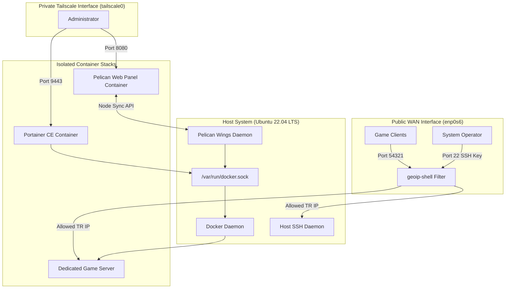
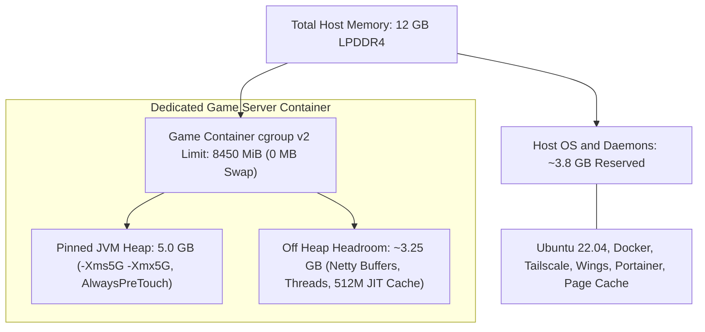

# Architecture and Infrastructure Decisions

**Languages:** [English](architecture.md) | [Türkçe](architecture.tr.md)

## 1. Project Background and System Context

This document details the architecture, hardware constraints, network topology, and runtime tuning on my Oracle Cloud (OCI) Ampere A1 ARM64 server.

I built this setup on an Always Free `VM.Standard.A1.Flex` instance (2 Ampere Altra OCPUs and 12 GB RAM in Frankfurt) to run isolated game server containers through Pelican alongside standalone Docker compose stacks managed in Portainer CE. The primary workload running on Pelican is a dedicated Minecraft server for players connecting from Turkey.

Working within fixed 12 GB host memory and 3.0 GHz ARM64 processor cores shaped the technical decisions across the stack. To keep the game loop stable without risking host stability or exposing admin panels to the public internet, I locked management dashboards behind a private Tailscale WireGuard mesh, filtered public WAN traffic at the firewall level with `geoip-shell`, partitioned host and container memory under Linux cgroups v2, and built a custom GraalVM 25 ARM64 runtime image. This document also covers two one time maintenance procedures from running this box: expanding the boot volume online from 50 GB to 100 GB when disk space ran low, and recovering the host through the OCI serial console and GRUB after an iptables rule locked out SSH.

## 2. Hardware and Environment Specifications

| Component | Specification | Role / Details |
| :--- | :--- | :--- |
| Compute Shape | VM.Standard.A1.Flex | 2 OCPUs, 12 GB RAM, Ampere Altra ARM64 |
| Cloud Region | eu-frankfurt-1 | Frankfurt (Availability Domain 1) |
| Operating System | Ubuntu 22.04 LTS | Linux kernel 6.8.0-1060-oracle (aarch64) |
| Network Interfaces | enp0s6, tailscale0, docker0, pelican_nw | Physical WAN, Tailscale overlay, container bridges |
| Container Engines | Docker 27.x, containerd | Container runtime and process isolation |
| Control Planes | Pelican Wings, Portainer CE | Pelican for game containers, Portainer for general Docker management |

### 2.1 OCI Compute Host Details

The virtual machine runs in the Frankfurt region under the Always Free resource tier:

## 3. Network Design and Ingress Flow

### 3.1 Public Ports and Authentication
I kept the public footprint on the physical interface `enp0s6` as small as possible:
- Port 22 (SSH): Accessible publicly, but password and keyboard interactive logins are strictly disabled in `/etc/ssh/sshd_config.d/60-cloudimg-settings.conf`. You can only connect with an authorized private SSH key.
- Port 54321: Dedicated port for game client connections.

### 3.2 Inbound Geoblocking with geoip-shell
To stop automated vulnerability probes and unauthorized traffic before it consumes host resources, I set up `geoip-shell`:
- Country whitelist: TR (Turkey)
- Registry database: RIPE
- Backend: iptables and ipset
- Filtering mode: Whitelist
- Trusted subnets: `100.64.0.0/10` (Tailscale) and `169.254.0.0/16` (OCI metadata and internal networking)
- Schedule: Daily cron job at 04:19 to update CIDR ranges, with an `@reboot` rule to restore rules after restarts

Using ipset is critical here. Instead of checking thousands of iptables rules sequentially with an O(N) cost per packet, ipset checks IP sets in an O(1) in memory hash table.

### 3.3 Management Plane Isolation via Tailscale
I decided not to expose any administrative web interfaces to the internet. Portainer (port 9443) and the Pelican Web Panel (port 8080) bind strictly to the private Tailscale interface (`tailscale0`).

This gives me an encrypted WireGuard mesh network between my personal devices and the server. I can manage containers securely from my laptop without opening web ports to external scanners or setting up external SSL reverse proxies.

### 3.4 Network Transport and TCP BBR Pacing
Since the server is hosted in Frankfurt (`eu-frankfurt-1`) and serves players connecting from Turkey across WAN routes, international transit can experience occasional packet loss and latency jitter.

To mitigate this, I enabled TCP BBR (`net.ipv4.tcp_congestion_control = bbr`) with Fair Queueing packet pacing (`net.core.default_qdisc = fq`) via sysctl. Unlike standard loss based algorithms like CUBIC that aggressively slash throughput upon transient packet drops, BBR estimates real bottleneck bandwidth and round trip time to pace packet transmission evenly. This maintains consistent packet delivery and lower connection jitter for game sessions.

## 4. Container Architecture and Docker Socket Sharing

### 4.1 Control Plane and Daemon Architecture
The system uses a decoupled container orchestration setup:
- Pelican Web Panel runs in Docker, serving the web UI for server allocation and user control.
- Pelican Wings runs on the host as a native systemd service (`wings.service`). It listens for API commands from the panel and manages game containers by communicating directly over `/var/run/docker.sock`.
- Portainer CE runs in Docker to manage standalone containers, compose stacks, and general Docker workloads outside of Pelican.

Both Portainer and Wings need access to `/var/run/docker.sock`. Because socket access is root equivalent on the host, game server workloads never touch the socket. They execute as unprivileged child containers bounded by strict cgroup limits.

*Figure: Portainer interface showing the isolated bridge networks across container stacks.*

### 4.2 Container Memory Budget and cgroup Accounting
To prevent the game server container from exhausting host memory or triggering disk swap, I divided the 12 GB physical RAM into strict boundaries:

- **Host Layer (~3.8 GB):** Leaves headroom for Ubuntu 22.04 LTS, Docker, Pelican Wings, Portainer CE, Tailscale, and kernel page cache so background daemons never face memory starvation.
- **Container Ceiling (8450 MiB, Swap Disabled):** In Pelican, I capped the game container at 8450 MiB (~8.25 GB) with swap set to 0 MiB, which Docker enforces on the host through Linux cgroups v2. Disabling swap guarantees that memory pressure never causes disk thrashing. If memory usage ever breaches 8450 MiB, the kernel cgroup OOM killer terminates only the game container while the host and management plane stay running.
- **In Container Heap vs Off Heap:** Inside the 8450 MiB ceiling, the JVM heap is pinned to 5 GB (`-Xms5G -Xmx5G`), leaving ~3.25 GB for off heap allocations including thread stacks, JIT code cache (`ReservedCodeCacheSize=512M`), native Netty direct network buffers, and shared libraries.
- **Page Fault Elimination (`-XX:+AlwaysPreTouch`):** Linux maps virtual memory pages lazily on first access. Under rapid world chunk loading, sudden bursts of minor page faults cause tick loop latency spikes. Passing `-XX:+AlwaysPreTouch` forces the JVM to touch and zero all committed physical pages across the 5 GB heap at startup, moving memory initialization cost entirely to boot time.

In addition, I tuned kernel dirty page writeback ratios in `/etc/sysctl.d/99-game-server.conf` (`vm.dirty_background_ratio = 5` and `vm.dirty_ratio = 10`). By default, Linux allows up to 20% of memory to fill with unwritten pages before forcing synchronous disk flushes. During game world autosaves, flushing large accumulated writes all at once can stall disk I/O. Lowering these ratios makes kernel flusher threads write dirty pages to storage earlier in smaller streams, avoiding autosave tick lag.

*Figure: Pelican environment configuration enforcing container memory and CPU bounds.*

### 4.3 Workload Runtimes and ARM64 GraalVM Optimization
Pelican manages isolated game servers using container runtime templates called Eggs. The platform supports two main workload profiles:
- Native Binary Workloads (C/C++, Go, Rust): Run directly in lightweight Linux containers with native ARM64 instruction execution and zero translation overhead.
- Minecraft Server Workload: The primary Java workload on this host is a Minecraft server, which runs its core game loop on a single thread at 20 ticks per second (a strict 50 ms budget per tick). While Ampere Altra Neoverse N1 processors provide strong multithreaded throughput, single core clock speeds (3.0 GHz) are lower than desktop x86 CPUs. Any JIT compilation stall or garbage collection pause over 50 ms directly causes dropped ticks.

To get better single thread performance on ARM64 without changing host packages, I built a custom container runtime image (`docker/graalvm-arm64/Dockerfile`) on top of `ghcr.io/pelican-eggs/yolks:debian` using GraalVM Community Edition JDK 25. Compared to the default OpenJDK HotSpot C2 compiler, GraalVM's modern escape analysis, loop unrolling, and method inlining passes generate tighter ARMv8 machine code for hot tick loops.

*Figure: Pelican dashboard displaying the active production container and standby runtime.*

### 4.4 Long Term Host Stability and Telemetry
Here is a snapshot of the system running under sustained load:
- Over 48 days of continuous uptime without reboots or OOM crashes.
- 6.55 GB memory used out of 11.7 GB total RAM.
- Background services running smoothly: containerd, iscsid, tailscaled, and oracle-cloud-agent.

*Figure: htop telemetry confirming stable memory usage, low CPU jitter, and 48 days of uptime.*

## 5. Live Boot Volume Expansion

The root filesystem sits on `/dev/sda1` using ext4 mounted with `discard,errors=remount-ro`. When the initial 50 GB boot volume ran low on space, I expanded it to 100 GB (and raised performance to 30 VPUs) in the OCI console without rebooting the host:
1. The Linux kernel detected the updated SCSI disk capacity immediately.
2. `growpart /dev/sda 1` expanded partition 1 to fill the new 100 GB block device.
3. `resize2fs /dev/sda1` resized the ext4 filesystem online while all containers kept running.

The exact commands are packaged in [`scripts/setup-storage.sh`](../scripts/setup-storage.sh) and documented in the [storage expansion runbook](runbooks/storage-expansion-vpu-tuning.md).
