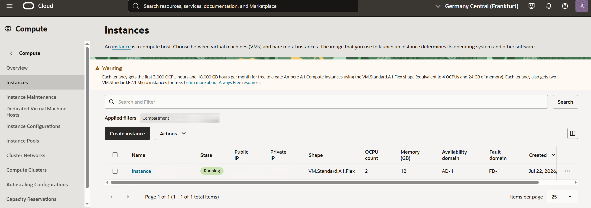
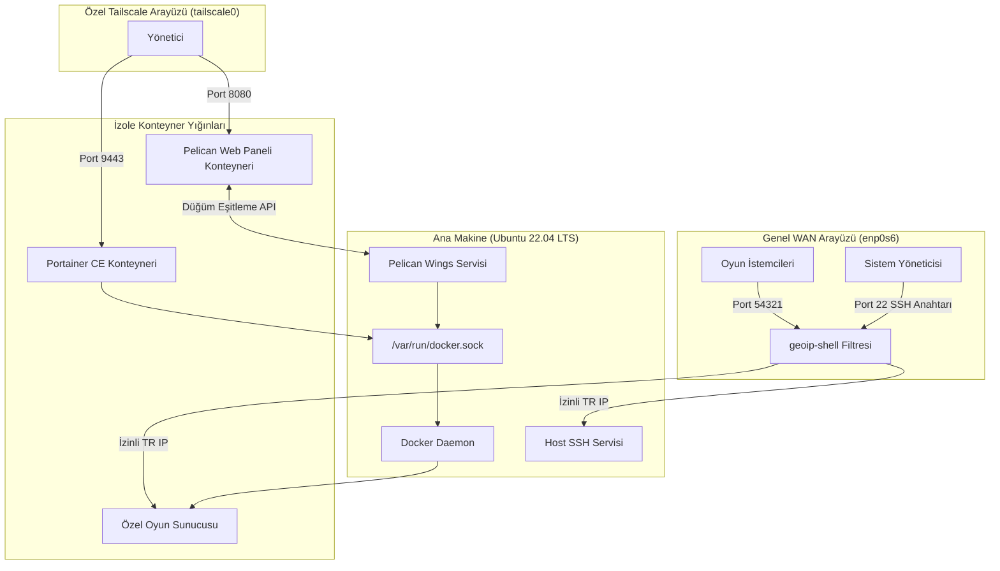
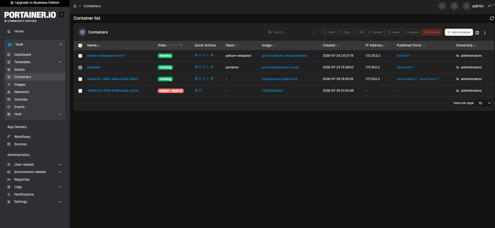
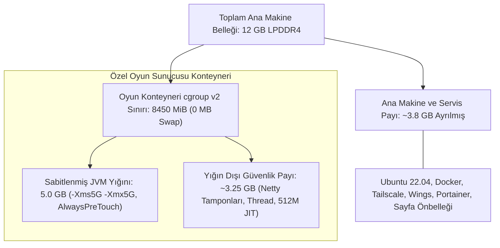
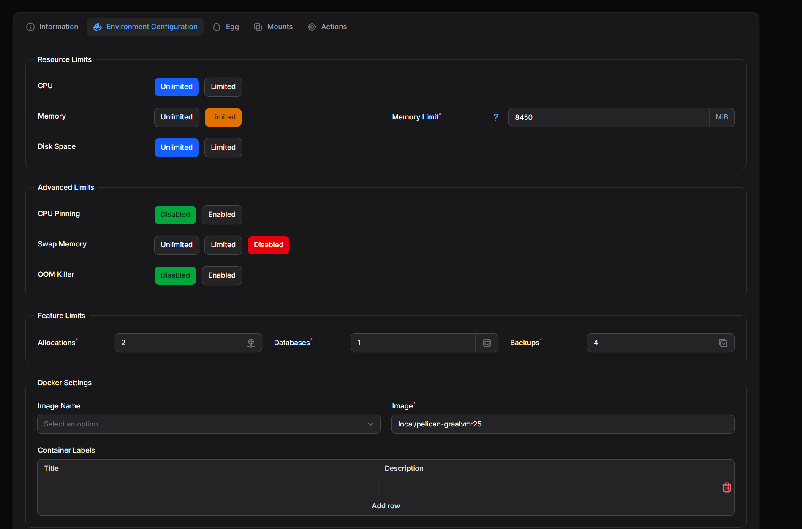
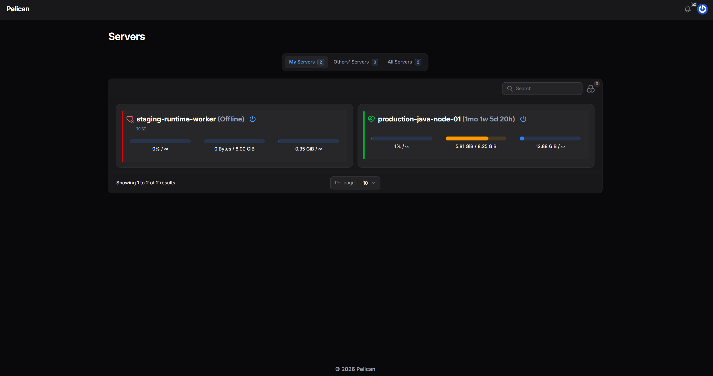
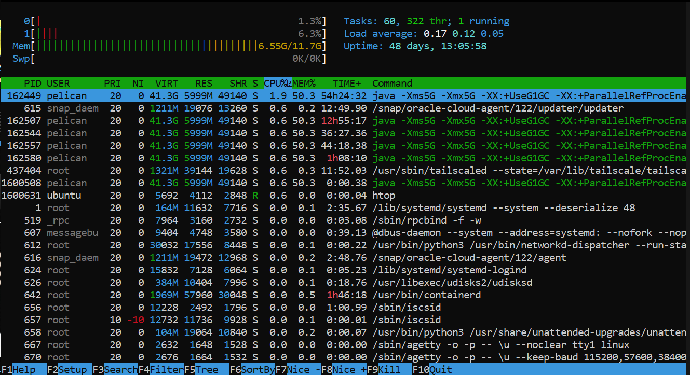

# Mimari ve Altyapı Kararları

**Diller:** [English](architecture.md) | [Türkçe](architecture.tr.md)

## 1. Proje Arka Planı ve Sistem Bağlamı

Bu doküman, Oracle Cloud (OCI) üzerindeki Ampere A1 ARM64 sunucumda uyguladığım mimari tercihleri, donanım kısıtlarını, ağ topolojisini ve çalışma zamanı ayarlarını detaylandırır.

Bu yapıyı Always Free katmanındaki bir `VM.Standard.A1.Flex` sunucusu (Frankfurt bölgesinde 2 Ampere Altra OCPU ve 12 GB RAM) üzerinde, Pelican aracılığıyla izole oyun sunucusu konteynerleri ve Portainer CE aracılığıyla bağımsız Docker compose yığınları çalıştırmak için kurdum. Pelican üzerinde çalışan ana iş yükü, Türkiye'den bağlanan oyunculara hizmet veren özel bir Minecraft sunucusudur.

Sabit 12 GB ana makine belleği ve 3.0 GHz ARM64 işlemci çekirdekleri altında çalışmak, sistemin her katmanındaki teknik tercihleri doğrudan belirledi. Ana makine kararlılığını riske atmadan veya yönetim panellerini genel internete açmadan oyun döngüsünü stabil tutmak için yönetim arayüzlerini özel Tailscale WireGuard ağı arkasına aldım, genel WAN trafiğini güvenlik duvarı seviyesinde `geoip-shell` ile filtreledim, ana makine ve konteyner belleğini Linux cgroups v2 sınırlarıyla böldüm ve özel bir GraalVM 25 ARM64 çalışma zamanı imajı derledim. Bu doküman ayrıca sunucuyu işletirken uyguladığım iki tek seferlik bakım işlemini de kapsar: disk alanı azaldığında açılış diskini sunucuyu kapatmadan 50 GB'tan 100 GB'a büyütmek ve hatalı bir iptables kuralı SSH erişimini kestiğinde sunucuyu OCI seri konsolu ve GRUB üzerinden kurtarmak.

## 2. Donanım ve Ortam Özellikleri

| Bileşen | Yapılandırma | Rol / Detaylar |
| :--- | :--- | :--- |
| Hesaplama Tipi | VM.Standard.A1.Flex | 2 OCPU, 12 GB RAM, Ampere Altra ARM64 |
| Bulut Bölgesi | eu-frankfurt-1 | Frankfurt (Availability Domain 1) |
| İşletim Sistemi | Ubuntu 22.04 LTS | Linux çekirdeği 6.8.0-1060-oracle (aarch64) |
| Ağ Arayüzleri | enp0s6, tailscale0, docker0, pelican_nw | Fiziksel WAN, Tailscale katmanı, konteyner köprüleri |
| Konteyner Motorları | Docker 27.x, containerd | Konteyner çalışma zamanı ve süreç izolasyonu |
| Kontrol Düzlemleri | Pelican Wings, Portainer CE | Oyun konteynerleri için Pelican, genel Docker yönetimi için Portainer |

### 2.1 OCI Hesaplama Sunucusu Detayları

Sanal makine Frankfurt bölgesinde OCI Always Free sınırları altında çalışmaktadır:

## 3. Ağ Tasarımı ve Giriş Trafiği Akışı

### 3.1 Genel Portlar ve Kimlik Doğrulama
Fiziksel `enp0s6` arayüzünde internete açık alanı olabildiğince dar tuttum:
- Port 22 (SSH): Genel ağa açıktır, ancak parola ile giriş `/etc/ssh/sshd_config.d/60-cloudimg-settings.conf` içinde kesinlikle kapatılmıştır. Yalnızca yetkili özel SSH anahtarı ile giriş yapılabilir.
- Port 54321: Oyuncuların bağlandığı özel oyun sunucusu portudur.

### 3.2 geoip-shell ile Coğrafi Filtreleme
Otomatik port tarayıcılarını ve yabancı bot trafiğini sunucu kaynaklarını tüketmeden önce kesmek için `geoip-shell` kurdum:
- İzin verilen ülke: TR (Türkiye)
- Veri tabanı kaynağı: RIPE
- Güvenlik duvarı arka ucu: iptables ve ipset
- Filtreleme modu: Beyaz liste (Whitelist)
- Güvenli iç ağlar: `100.64.0.0/10` (Tailscale) ve `169.254.0.0/16` (OCI meta veri ve iç ağı)
- Zamanlama: Her sabah 04:19 saatinde IP bloklarını güncelleyen cron görevi ve sistem açılışında otomatik geri yükleme

Burada ipset kullanımı çok önemlidir. Binlerce iptables kuralını paket başına O(N) maliyetle tek tek aratmak yerine, ipset IP eşleşmelerini bellekteki karma tablosunda O(1) sabit zaman karmaşıklığıyla yapar.

### 3.3 Tailscale ile Yönetim Düzlemi İzolasyonu
Web panellerini genel internete hiç açmama kararı aldım. Portainer (9443) ve Pelican Web Paneli (8080) yalnızca özel Tailscale arayüzünü (`tailscale0`) dinler.

Bu sayede kendi bilgisayarımla sunucu arasında şifreli bir WireGuard mesh ağı kurmuş oldum. Dışarıdan gelen tarayıcılara port açmadan veya karmaşık SSL ters vekil yapılandırmalarıyla uğraşmadan tüm servislerimi dizüstü bilgisayarımdan güvenle yönetebiliyorum.

### 3.4 Ağ İletimi ve TCP BBR Trafik Düzenleme
Sunucu Frankfurt (`eu-frankfurt-1`) bölgesinde yer aldığı ve oyuncular Türkiye üzerinden genel internet aracılığıyla bağlandığı için uluslararası veri hatlarında anlık paket kayıpları ve gecikme dalgalanmaları yaşanabilmektedir.

Bunu çözmek için sysctl üzerinden Fair Queueing paket kuyruklama (`net.core.default_qdisc = fq`) ile birlikte TCP BBR (`net.ipv4.tcp_congestion_control = bbr`) tıkanıklık kontrolünü devreye aldım. Geçici paket kayıplarında bant genişliğini sert bir şekilde düşüren CUBIC gibi klasik algoritmaların aksine BBR, gerçek hat kapasitesini ve gidiş dönüş süresini (RTT) modelleyerek paketleri düzenli bir tempoda iletir. Bu da oyun trafiğindeki gecikme dalgalanmalarını ve takılmaları azaltır.

## 4. Konteyner Mimarisi ve Docker Soket Paylaşımı

### 4.1 Kontrol Düzlemi ve Servis Mimarisi
Sistem birbirinden bağımsız servislerden oluşan bir yönetim mimarisi kullanır:
- Pelican Web Paneli: Docker içinde çalışır ve kullanıcı, sunucu ve kaynak kontrollerini web arayüzünden sunar.
- Pelican Wings: Ana makinede yerel systemd servisi (`wings.service`) olarak çalışır. Panelden gelen komutları dinler ve `/var/run/docker.sock` üzerinden Docker ile doğrudan haberleşerek oyun konteynerlerini yönetir.
- Portainer CE: Pelican dışındaki bağımsız konteynerleri, compose yığınlarını ve genel Docker işlerini yönetmek için Docker içinde çalışır.

Hem Portainer hem de Wings servisleri `/var/run/docker.sock` soketine ihtiyaç duyar. Soket erişimi ana makinede root yetkisine denk olduğu için oyun sunucusu gibi kullanıcı iş yükleri sokete asla dokunamaz. Onlar cgroup sınırları altındaki izole çocuk konteynerler olarak çalışır.

*Şekil: Konteyner yığınları arasındaki izole ağ köprülerini gösteren Portainer arayüzü.*

### 4.2 Konteyner Bellek Bütçesi ve cgroup Muhasebesi
Oyun sunucusu konteynerinin ana makine belleğini tüketmesini veya disk takasına (swap) girmesini önlemek için 12 GB fiziksel RAM'i katı çalışma sınırlarına böldüm:

- **Ana Makine Katmanı (~3.8 GB):** Ubuntu 22.04 LTS, Docker, Pelican Wings, Portainer CE, Tailscale ve çekirdek sayfa önbelleği için güvenlik payı bırakır, böylece arka plan sistem servisleri bellek yetersizliği yaşamaz.
- **Konteyner Tavanı (8450 MiB, Takas Kapalı):** Pelican üzerinde oyun konteynerini takas alanı kapalı (0 MiB) olacak şekilde 8450 MiB (~8.25 GB) ile sınırlandırdım. Docker bu sınırı ana makinede doğrudan Linux cgroups v2 üzerinden uygular. Takas alanının kapatılması bellek baskısında disk takası yaşanmasını engeller. Bellek kullanımı 8450 MiB sınırını aşarsa çekirdek cgroup OOM katili ana makineyi ve yönetim panellerini etkilemeden yalnızca oyun konteynerini sonlandırır.
- **Konteyner İçi Yığın ve Yığın Dışı Payı:** 8450 MiB sınırının içinde JVM yığın belleği 5 GB (`-Xms5G -Xmx5G`) olarak sabitlendi. Kalan ~3.25 GB alan iş parçacığı yığınları, JIT derleme önbelleği (`ReservedCodeCacheSize=512M`), yerel Netty doğrudan ağ tamponları ve paylaşımlı kütüphaneler için yığın dışı alan olarak ayrıldı.
- **Sayfa Hatası Önleme (`-XX:+AlwaysPreTouch`):** Linux sanal bellek sayfalarını ilk erişimde tembel (lazy) olarak eşler. Hızlı harita yükleme anlarında ortaya çıkan ani sayfa hataları oyun döngüsünde gecikme sıçramalarına yol açar. `-XX:+AlwaysPreTouch` parametresiyle JVM'in açılışta 5 GB alandaki tüm fiziksel sayfaları eşleyip sıfırlamasını sağlayarak bellek hazırlama maliyetini tamamen açılış anına çektim.

Ayrıca `/etc/sysctl.d/99-game-server.conf` dosyasında çekirdek kirli bellek sayfası oranlarını (`vm.dirty_background_ratio = 5` ve `vm.dirty_ratio = 10`) düzenledim. Varsayılan Linux ayarlarında belleğin yüzde 20 kadarı diske yazılmamış sayfalarla dolabilmekte ve ardından zorunlu senkron yazma tetiklenmektedir. Oyun dünyası otomatik kaydedilirken (autosave) biriken büyük verilerin tek seferde diske yazılması giriş çıkış tıkanıklıklarına yol açabilir. Bu oranları düşürerek çekirdek yazıcı iş parçacıklarının kirli sayfaları diske daha erken ve küçük akışlar halinde yazmasını sağladım, böylece kayıt anındaki takılmaların önüne geçtim.

*Şekil: Konteyner bellek ve işlemci sınırlarını uygulayan Pelican ortam yapılandırması.*

### 4.3 İş Yükü Çalışma Zamanları ve ARM64 Üzerinde GraalVM Optimizasyonu
Pelican, izole oyun sunucularını Egg adı verilen konteyner çalışma zamanı şablonlarıyla yönetir. Platform iki ana iş yükü profilini destekler:
- Yerel İkilikler (C/C++, Go, Rust): Doğrudan hafif Linux konteynerlerinde çalışır, yerel ARM64 komutlarını doğrudan yürütür ve çeviri ek yükü oluşturmaz.
- Minecraft Sunucu İş Yükü: Bu sunucudaki ana Java iş yükü, ana oyun döngüsünü saniyede 20 tick (tick başına 50 ms katı bir süre sınırı) hızında tek bir iş parçacığında yürüten bir Minecraft sunucusudur. Ampere Altra Neoverse N1 işlemciler yüksek çoklu iş parçacığı verimi sunsa da tek çekirdek saat hızları (3.0 GHz) masaüstü x86 işlemcilere kıyasla daha düşüktür. 50 ms'yi aşan herhangi bir JIT derleme gecikmesi veya çöp toplama (GC) duraklaması doğrudan tick kaybına yol açar.

Ana makine paketlerini değiştirmeden ARM64 üzerinde tek iş parçacığı performansını artırmak için `ghcr.io/pelican-eggs/yolks:debian` tabanında GraalVM Community Edition JDK 25 kullanan özel bir konteyner çalışma zamanı imajı (`docker/graalvm-arm64/Dockerfile`) derledim. Varsayılan OpenJDK HotSpot C2 derleyicisine kıyasla GraalVM'in modern kaçış analizi, döngü açma ve fonksiyon içi genişletme aşamaları sıcak oyun döngüleri için daha sıkı ARMv8 makine kodu üretir.

*Şekil: Aktif sunucuyu ve hazırda bekleyen konteyner çalışma zamanını gösteren Pelican paneli.*

### 4.4 Uzun Süreli Sistem Kararlılığı ve Telemetri
Sistemin kesintisiz yük altındaki çalışma görüntüsü:
- Yeniden başlatma veya OOM düşmesi olmadan 48 günü aşan kesintisiz çalışma süresi.
- 11.7 GB RAM içinde 6.55 GB stabil bellek kullanımı.
- Arka planda sorunsuz çalışan servisler: containerd, iscsid, tailscaled ve oracle-cloud-agent.

*Şekil: Düşük işlemci yükünü ve 48 günlük kesintisiz çalışma süresini doğrulayan htop telemetrisi.*

## 5. Canlı Açılış Diski Genişletme

Kök dosya sistemi `/dev/sda1` üzerinde `discard,errors=remount-ro` seçenekleriyle bağlı ext4 dosya sistemidir. Başlangıçtaki 50 GB açılış diskinde yer azaldığında, sunucuyu yeniden başlatmadan OCI konsolundan diski 100 GB boyutuna (ve performansını 30 VPU seviyesine) çıkardım:
1. Linux çekirdeği güncellenen SCSI disk kapasitesini anında algıladı.
2. `growpart /dev/sda 1` komutu 1 numaralı bölümü yeni 100 GB blok aygıtının sonuna kadar genişletti.
3. `resize2fs /dev/sda1` komutu tüm konteynerler çalışmaya devam ederken ext4 dosya sistemini çevrim içi olarak büyüttü.

Kullanılan komutlar [`scripts/setup-storage.sh`](../scripts/setup-storage.sh) betiğinde toplanmış ve [depolama genişletme rehberinde](runbooks/storage-expansion-vpu-tuning.tr.md) detaylıca açıklanmıştır.
